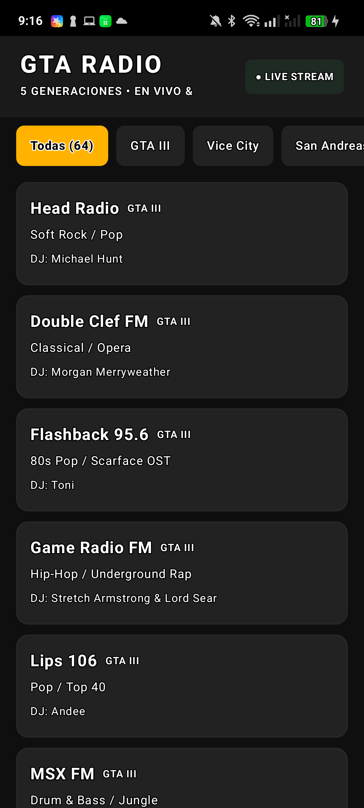
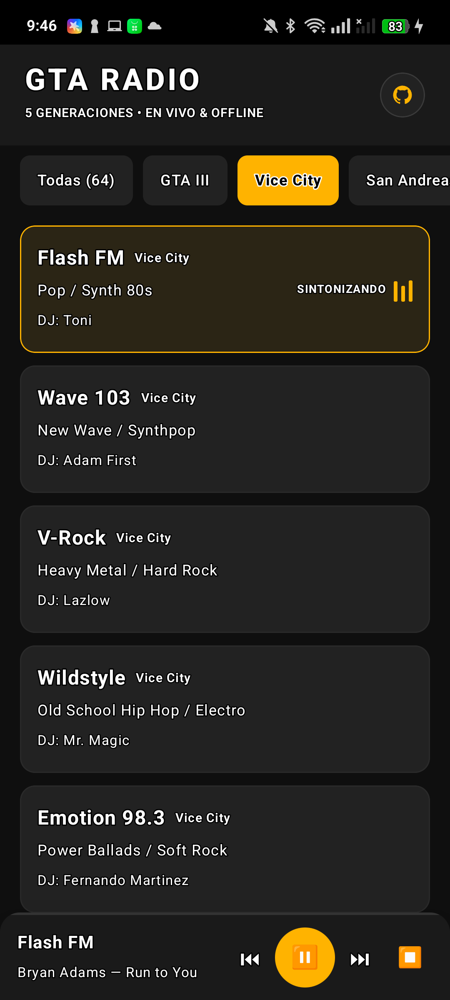
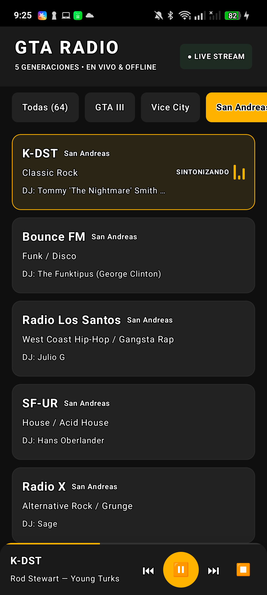
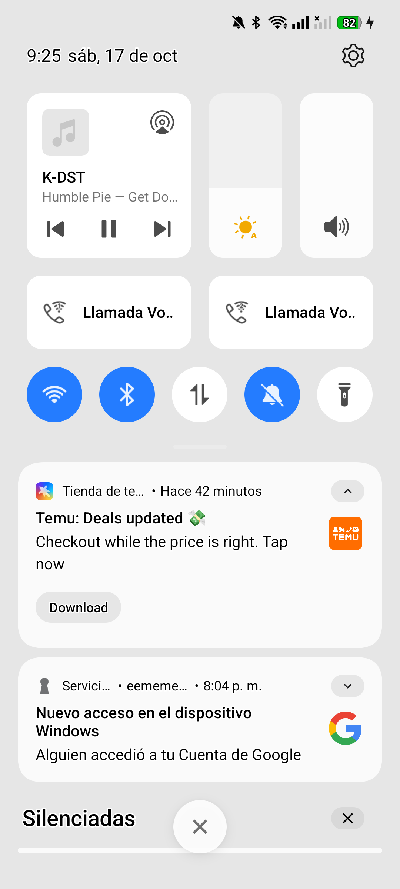

# 📻 GTA Radio — Native Android App (5 Generaciones en Vivo & Offline)

Aplicación Android 100% nativa en Kotlin con **Jetpack Compose** y **AndroidX Media3 (`ExoPlayer` + `MediaSessionService`)**, diseñada bajo **Clean Architecture** y principios **SOLID**.

### 📲 [Descargar APK Oficial (`GTA-Radio-Real.apk` — 12.2 MB)](https://github.com/emmahiguita/Radio-Gta/raw/main/GTA-Radio-Real.apk)


## 📸 Capturas Reales en Dispositivo (Dentro y Fuera de la App)

| Catálogo Completo (64 Emisoras) | Vice City — Flash FM | San Andreas — K-DST | Segundo Plano / Notificación |
| :---: | :---: | :---: | :---: |
|  |  |  |  |

## 🔥 Características Principales
- **5 Generaciones de Grand Theft Auto (64 emisoras reales completas):** GTA III, Vice City, San Andreas, GTA IV y GTA V con DJs originales, comerciales y canciones completas verificadas en Archive.org.
- **Dentro y Fuera de la App (`MediaSessionService` + `WAKE_MODE_NETWORK`):** Reproducción continua con pantalla apagada, en la pantalla de inicio o usando otras aplicaciones, con controles nativos (`⏮`, `⏸`, `⏭`) en notificaciones, pantalla de bloqueo y Bluetooth.
- **Reloj de Emisión en Vivo (`RadioClock`):** Todas las emisoras transmiten en paralelo sincronizadas con el reloj del sistema, igual que al subirte a un vehículo en GTA, con salto instantáneo CBR (`FLAG_ENABLE_CONSTANT_BITRATE_SEEKING`).
- **Modo Offline Inteligente (`OfflineAudioResolver`):** Detección automática en segundo plano (`Dispatchers.IO`) de emisiones completas en `/sdcard/GTA_Radio/` con fallback transparente a streaming en vivo.
- **Código Limpio:** Arquitectura desacoplada sin bloqueos de UI.

## 📂 Estructura del Almacenamiento Local (Offline)
Para reproducir sin conexión, coloca las emisiones completas (`.mp3` / `.ogg` / `.m4a`) en:
```
Memoria interna/GTA_Radio/
  ├── GTA_III/
  ├── GTA_Vice_City/
  ├── GTA_San_Andreas/
  ├── GTA_IV/
  └── GTA_V/
```

## 🛠️ Requisitos de Compilación
- JDK 17+
- Android SDK (API 34 / Build Tools 34.0.0)
- Gradle 8.7
